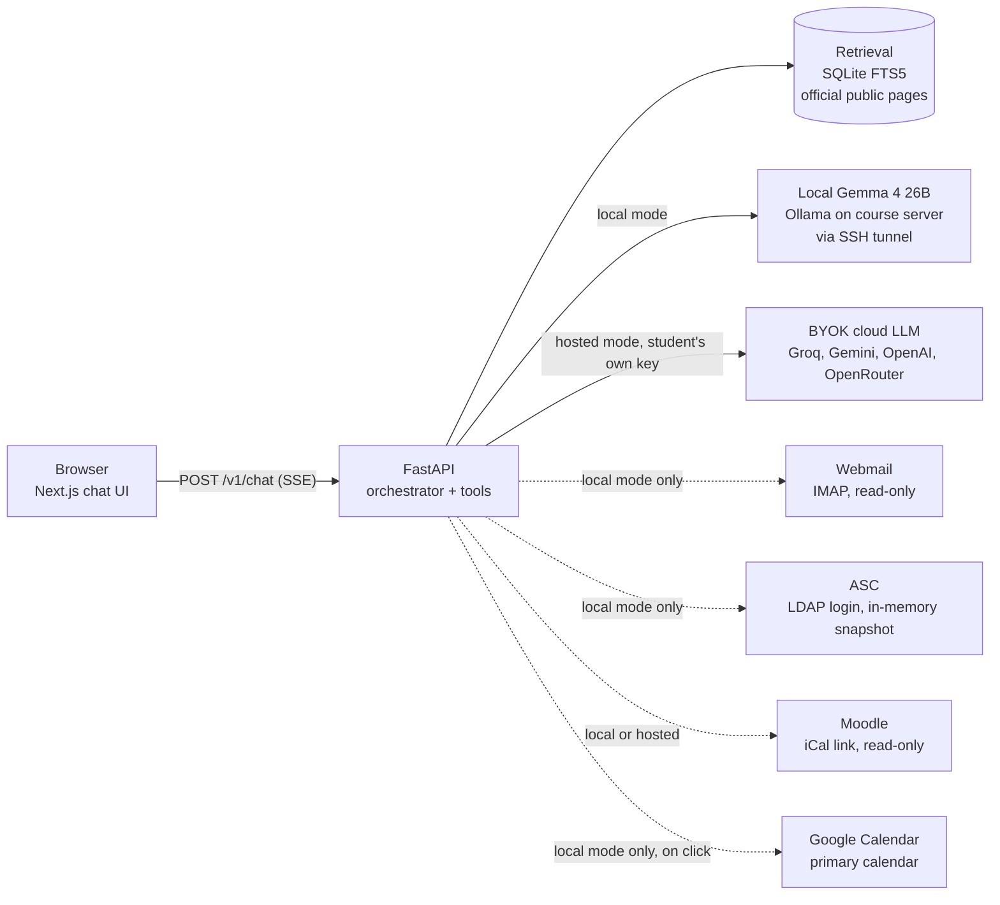

# CampusPilot

CampusPilot is a chat assistant for IIT Bombay students. Ask a question in plain language and get a short answer with citations to official public IITB pages, plus a read-only view of your own Moodle deadlines. In the local app it can also read your webmail (and suggest Google Calendar events you confirm with one click) and your ASC timetable, courses, registration and profile. It runs in two modes from one codebase: **local** (the model is Gemma 4 26B on the IEOR course server, reached through an SSH tunnel) and **hosted** (public Q&A only, where each student brings their own free LLM key, for example Groq). The retrieval index is SQLite FTS5 over a registry of approved public sources. Personal connectors run only on your own computer.

> **Disclaimer.** CampusPilot is an IE624 student prototype. It is **not an official IIT Bombay service** and is not affiliated with IIT Bombay. Answers can be wrong or out of date. Always check the official page linked in each answer, and contact the responsible office for anything that matters.


## Architecture



Solid arrows are used in every mode. Dashed arrows are connectors. Webmail, ASC and Google Calendar are never mounted in hosted mode. More detail: [docs/ARCHITECTURE.md](docs/ARCHITECTURE.md) and the API contract [docs/CONTRACT.md](docs/CONTRACT.md).

## Live pilot

- **Try it:** https://iitb-campus-assistant.vercel.app (API on Render: https://campuspilot-api-mve5.onrender.com). The free server sleeps when idle, so the first request can take about a minute.
- **Bring your own free key.** CampusPilot has no AI account of its own. Make a free [Groq](https://console.groq.com/keys) key (no card) and paste it in the welcome card. See [docs/STUDENT_GUIDE.md](docs/STUDENT_GUIDE.md).
- **Privacy in three bullets:**
  - Your key and your Moodle link stay in your browser. They are sent with each request and used once. The server never stores or logs them.
  - Your questions and the excerpts of official pages used to answer go to the AI provider you chose. Your Moodle content is never sent to any LLM.
  - The server keeps nothing about you. Webmail, ASC and Google Calendar do not exist on the hosted site.

## Features

- **Cited Q&A over official IITB pages.** Each answer cites the pages it came from, and each citation card links to the source. When the sources do not cover a question, it says so and points to the right office. For ambiguous questions it asks one clarifying question.
- **Moodle deadlines (read-only).** "What's due this week?" shows deadline cards from your Moodle calendar (iCal) link. Nothing is ever written to Moodle.
- **Webmail events to Google Calendar (local only).** Read-only IMAP search of your mail, event detection, and an **Add** button on each event card. An event is created only when you click Add, in your primary calendar, and never twice (dedupe).
- **ASC (local only).** Your timetable, current courses, registration status and profile, plus public data: courses offered by department, offering history and course details. Grades are never read.
- **Demo mode.** With nothing connected, deadline and connector cards come from clearly labelled demo fixtures.
- **Honest offline state.** If the model is unreachable, the UI says so and still offers the official links.

## Privacy design

- **Connectors run only locally.** In hosted mode the connector router is not mounted and the tools are not offered, whatever the flags say.
- **Secrets in the macOS Keychain.** LDAP id, mail access token, ASC password, Google token and the Moodle link are stored in the Keychain, never in files or the repo, and never logged.
- **Read-only.** Mail is fetched with IMAP `BODY.PEEK` (never marks mail as read; no send, move or delete). Moodle and ASC are read only. ASC is limited to an allowlist of pages.
- **Personal data goes only to the local Gemma.** Mail text is read only by the local model. Your own ASC data is offered only when the chat model is local; the model sees a count and the cards go straight to the UI. With a cloud model, CampusPilot refuses personal ASC questions and answers only from public data.
- **Moodle content is never sent to any LLM**, in either mode.
- **No grades.** Grades, SPI/CPI and the performance summary are never read.
- **Local binding.** The API and UI bind to `127.0.0.1` only. Chat history stays in your browser.

## How to run

Prerequisites: macOS, [uv](https://docs.astral.sh/uv/), Node 20 or newer. For the real model you need your own access to the course server and an SSH alias named `passpoli-llm`, while on campus Wi-Fi or the IITB VPN (the model server is not reachable otherwise). Without that, use mock mode.

```sh
git clone https://github.com/biprabhanu/iitb-campus-assistant.git
cd iitb-campus-assistant
make setup                 # installs the API and web dependencies
cp .env.example .env       # untracked; never commit it
```

### Mock (no tunnel, no model)

```sh
make mock-dev              # then open http://127.0.0.1:3000
```

A scripted fake model answers. Real tools and the index still run. On a fresh clone it first builds a small demo index from synthetic pages (cards say "Demo fixture, not official"). Run `make ingest` to index the real pages (needs internet; it fetches slowly on purpose, see [docs/SOURCES.md](docs/SOURCES.md)).

### Local (real Gemma)

```sh
ssh -fN passpoli-llm       # open the tunnel (127.0.0.1:11500)
make tunnel-check          # should print: tunnel: up
make dev                   # API on 127.0.0.1:8000, UI on 127.0.0.1:3000
```

To turn on the connectors, set `WEBMAIL_ENABLED=true`, `ASC_ENABLED=true` and `GCAL_ENABLED=true` in `.env` (or on the command line) and connect each one under **Settings, Connectors**. The one-liner the owner uses:

```sh
cd ~/Projects/iitb-campus-assistant && make setup && { pgrep -f "ssh -fN passpoli-llm" >/dev/null || ssh -fN passpoli-llm; } && make tunnel-check && { (sleep 25; open http://127.0.0.1:3000) & WEBMAIL_ENABLED=true ASC_ENABLED=true GCAL_ENABLED=true make dev; }
```

Connector setup (LDAP id and access token, Google "Desktop app" OAuth client) is in [docs/STUDENT_GUIDE.md](docs/STUDENT_GUIDE.md).

### Moodle (optional, read-only)

In Moodle go to **Calendar, Export calendar**, choose **All events** and **Recent and next 60 days**, click **Get calendar URL**, and paste the link in **Settings, Moodle**. The link carries a private `authtoken`, so treat it like a password. Locally it goes to the macOS Keychain; on the hosted site it stays in your browser. Disconnect from Settings. Check it from the command line with `make moodle-check`.

### Hosted

The hosted pilot is the Vercel UI plus the Render API above. To deploy your own copy, follow [docs/DEPLOY.md](docs/DEPLOY.md). To check a deployed API: `make smoke-hosted URL=<api-url> ORIGIN=<ui-url>`. To run the hosted image locally: `make docker-build` then `make docker-run` (127.0.0.1:8001).

## Tests

On 27 Nov 2026 `make test` passed with **581 pytest tests**, ruff, eslint, `tsc`, `next build` and **59 Playwright smoke tests**, offline. A fresh clone with no `.env` passes the same run.

| Command | What it runs |
|---|---|
| `make test` | Everything below (offline): pytest, ruff, eslint, tsc, next build, Playwright smoke |
| `make test-api` | pytest and ruff for the API |
| `make test-web` | Lint, type-check, production build and the Playwright smoke test |
| `make acceptance` | Live 25-question check against the local model (needs the tunnel and the API). `python scripts/acceptance_check.py --api-url <api>` runs it against a hosted API with your own key from `.env` |
| `make secrets-check` | The security sweep |
| `make screenshots` | Regenerates `docs/screenshots/` |

Evaluation (a small single-user check, not a benchmark): local Gemma 96% expected behaviour and 75% expected source cited; hosted Groq (own key, first untuned run, 27 Nov 2026) 68% and 12%, with first-token latency 1.8 s median versus 6.2 s. Details and caveats in [docs/EVAL.md](docs/EVAL.md).

## Limitations

- Answers come from a small index (9 ingested sources, 44 documents). Anything outside it gets "couldn't verify" and an office link. The acceptance questions were written by the build team, and the prompts were tuned while looking at them, so the numbers are optimistic.
- **Hostel rules cannot be cited.** The official PDF is a scan with no text layer and there is no OCR. It is a link-only source. See [docs/SOURCES.md](docs/SOURCES.md#known-limitations).
- Connectors are local only and need macOS (Keychain), the campus network or VPN (ASC, webmail), and your own Google OAuth client.
- ASC's fees page is only a scholarship-payment month picker, so there is no fee table to show. The parsers follow ASC's current page layout and may need updates if it changes.
- Only Groq has been tested as a hosted provider. Gemini, OpenAI and OpenRouter are `not_tested`.
- The free hosted server sleeps when idle and Groq's free tier has token limits, so the hosted site can be slow or briefly rate-limited.
- Moodle may not be reachable from the hosted server; the local app always can.

## Project layout

```text
iitb-campus-assistant/
├── Makefile                 # all developer commands (make help)
├── apps/
│   ├── api/campuspilot/     # FastAPI backend (Python 3.12, uv)
│   │   ├── agent/           # orchestrator, prompts, citation checks, personal answers
│   │   ├── api/             # routes, SSE, hosted headers, rate limits
│   │   ├── asc/             # ASC connector (local only)
│   │   ├── gcal/            # Google Calendar connector (local only)
│   │   ├── mail/            # Webmail IMAP connector (local only)
│   │   ├── ingestion/       # registry, polite fetcher, parsing, chunking, SQLite
│   │   ├── llm/             # Ollama, BYOK and mock clients
│   │   ├── moodle/          # iCal and REST clients, Keychain, demo data
│   │   └── retrieval/       # SQLite FTS5 search
│   └── web/                 # Next.js chat UI
├── data/                    # sources/registry.csv, eval questions, fixtures
├── docs/                    # architecture, contract, API, deploy, eval, guides
└── scripts/                 # ingest, reindex, acceptance, smoke, index release
```

Generated and private files (`.env`, `data/campuspilot.db`, `data/raw/`, `.venv`, `node_modules`) are gitignored.

## Troubleshooting

- **`make tunnel-check` says DOWN, or `ssh -fN passpoli-llm` reports "Address already in use" on port 11500.** The tunnel is probably already running. Run `make tunnel-check` to confirm; if it still fails, close the old tunnel and open it again.
- **"Model offline" in the UI.** The tunnel is down, or you are off the IITB network. Reconnect, run `make tunnel-check`, and try again.
- **The first answer is slow.** The model loads into GPU memory on the first request after idle (about 9 seconds when we measured).
- **`make ingest` skips some pages.** Some IITB pages are unreachable or scanned PDFs with no text. That is expected; see [docs/SOURCES.md](docs/SOURCES.md).
- **No deadline cards.** Without a connected Moodle you see labelled demo cards. Otherwise run `make moodle-check` and check Settings.

## Docs

[docs/EVAL.md](docs/EVAL.md) (acceptance numbers) · [docs/REPRODUCE.md](docs/REPRODUCE.md) (reproduce the build and the numbers) · [docs/STUDENT_GUIDE.md](docs/STUDENT_GUIDE.md) (using the pilot) · [docs/FINAL_REPORT.md](docs/FINAL_REPORT.md) (final report) · [docs/API.md](docs/API.md) · [docs/DEPLOY.md](docs/DEPLOY.md) · [docs/SOURCES.md](docs/SOURCES.md)

## Author

Bipra Bhanu Mohanty (IE624 course project, IIT Bombay).
