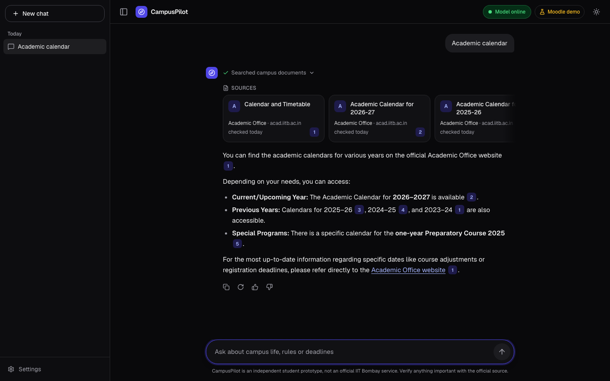

# CampusPilot

CampusPilot is a chat assistant for IIT Bombay students. Ask a question in plain language and get a short answer with citations to official public IITB pages, or a read-only summary of your own Moodle deadlines and courses. The API, web UI and document index run on your Mac; the language model (Gemma 4 26B via Ollama) runs on the IEOR course server and is reached through an SSH tunnel. Nothing is sent to a cloud service by default.

> **Disclaimer.** CampusPilot is an IE624 student prototype. It is **not an official IIT Bombay service** and is not affiliated with IIT Bombay. Answers can be wrong or out of date. Always check the official page linked in each answer, and contact the responsible office for anything that matters.

## Status (26 Nov 2026)

Honest status words only: `implemented_and_tested`, `implemented_not_tested`, `blocked`.

| Definition of done | Status | Evidence |
|---|---|---|
| `make dev` starts API + UI on 127.0.0.1 | implemented_and_tested | both listen on 127.0.0.1 only (lsof) |
| Academic calendar → streamed answer with validated citation cards | implemented_and_tested | live Gemma; see `docs/screenshots/live-answer-*.png` |
| "What's due this week?" → Moodle deadline cards | implemented_and_tested (demo fixtures) | live Moodle token **not tested** (no token was provided) |
| Unanswerable question → "couldn't verify" + office link | implemented_and_tested | live; `live-abstain-*.png` |
| Ambiguous question → one clarifying question | implemented_and_tested | live, 6/6 stable runs |
| Tunnel down → "Model offline", nothing crashes | implemented_and_tested | live with a closed port; unit tests |
| pytest, ruff, lint, type-check, build, Playwright | implemented_and_tested | `make test` exits 0 (139 pytest, 7 Playwright) |
| Screenshots at 1440 and 390 px, both themes | implemented_and_tested | `docs/screenshots/` (reviewed) |
| No secrets, IPs, usernames, tokens, raw data or DBs in Git | implemented_and_tested | `make secrets-check` + username grep |

Acceptance check (25 questions, live, a small single-user check, not a benchmark): **96%** expected
behaviour, **75%** expected source cited, median time to first token 6.2 s. Details and caveats in
[docs/EVAL.md](docs/EVAL.md).

**Known limitation: hostel rules can't be cited.** The official *Hostel Rules and Regulations* PDF
(`SRC-HOSTEL-RULES`) is a scanned document with no text layer, and v1 has no OCR. It is kept as a
link-only source: CampusPilot can point you to the PDF, but it can't quote or cite it. Hostel
questions are answered from the Hostel Affairs Council FAQ (student-body guidance, tier 2) where it
covers them. Otherwise CampusPilot says it couldn't verify the answer and links the rules PDF. See
[docs/SOURCES.md](docs/SOURCES.md#known-limitations).




## Features

- **Cited Q&A over official IITB pages.** Answers cite the pages they come from (calendar, entrants, Dean of Student Affairs rules and similar). Each citation card links to the source page. When the sources don't cover a question, CampusPilot says so and points you to the right office or portal.
- **Clarifying questions.** For ambiguous questions such as "Can I change my room?", it asks one clarifying question instead of guessing.
- **Read-only Moodle.** "What's due this week?" shows deadline cards, and course lists and contents are available when a token is connected. CampusPilot never writes to Moodle.
- **Demo mode.** With nothing connected, deadline cards come from clearly labelled demo fixtures ("Demo data").
- **Honest offline state.** If the model is unreachable, the UI shows "Offline" with a helpful message and the official links it can still offer.

## Prerequisites

- macOS (the Moodle token is stored in the macOS Keychain; the Makefile targets are written for macOS).
- [uv](https://docs.astral.sh/uv/) (installs the Python 3.12 virtual environment for the API).
- Node 20 or newer, with npm.
- IITB network access (campus Wi-Fi or LAN, or the IITB VPN when off campus) for the model tunnel. The model server is only reachable from inside the campus network. You can skip this with `make mock-dev`.

## Setup from scratch

1. Clone the repository and enter it:

   ```sh
   git clone https://github.com/biprabhanu/iitb-campus-assistant.git
   cd iitb-campus-assistant
   ```

2. Install the API and web dependencies (creates `apps/api/.venv` and installs Playwright's Chromium):

   ```sh
   make setup
   ```

3. Create your local configuration. `.env` is untracked and must never be committed:

   ```sh
   cp .env.example .env
   ```

4. Open the model tunnel to the course server. You need your own access to the course server and an SSH config alias named `passpoli-llm` on your machine. Ask the course team for access. Do not share or copy anyone else's SSH keys or config.

   ```sh
   ssh -fN passpoli-llm
   ```

5. Check that the tunnel is up. It should print `tunnel: up`:

   ```sh
   make tunnel-check
   ```

6. Build the document index from the approved sources. This fetches slowly on purpose (see [docs/SOURCES.md](docs/SOURCES.md)):

   ```sh
   make ingest
   ```

7. Start the API and the web UI together:

   ```sh
   make dev
   ```

   Open http://127.0.0.1:3000.

## Running without the tunnel

For demos and UI work, use the scripted fake model. Real tools and the index still run, but the answers are canned:

```sh
make mock-dev
```

Then open http://127.0.0.1:3000.

This works on a fresh clone, with no tunnel and nothing ingested:

- If `data/campuspilot.db` is missing, `make mock-dev` first builds a small demo index from the synthetic pages in `data/fixtures/docs/` (`scripts/build_demo_index.py`). Those cards say **"Demo fixture, not official"**, and the sample text is not real IITB information. An existing index is never touched.
- Official office and portal links come straight from `data/sources/registry.csv`, so they work even with an empty database.
- "Where can I find the academic calendar?" then gives a cited answer whose card links to the official calendar page.
- To switch to the real pages, run `make ingest` (needs internet). It removes the demo sources first. To rebuild the demo index, delete `data/campuspilot.db` and run `make mock-dev` again.

## Connecting Moodle (optional, read-only)

You can connect Moodle in the app under **Settings**. The app never asks for your Moodle password.

1. In Moodle, go to **Preferences → Security keys** and copy the key labelled **"Moodle mobile web service"**, if it is listed. IITB may not enable this for every account.
2. Paste the key into **Settings → Moodle**. The app verifies it with Moodle and stores it in the macOS Keychain. The browser does not keep it, and the token is never shown again.
3. If the web service key is not available, use the calendar fallback: in Moodle, go to **Calendar → Export calendar**, copy the URL, and paste it in the same Settings field. CampusPilot reads deadlines from that link. In this mode, course lists and contents are not available, and the UI says so.
4. To remove the connection, click **Disconnect Moodle** in **Settings**. This deletes the token and calendar link from the Keychain.

You can also set `MOODLE_TOKEN` or `MOODLE_ICAL_URL` in `.env`. Settings is the recommended route because it keeps the value out of files. Check a token or calendar link from the command line with:

```sh
make moodle-check
```

With nothing connected, `MOODLE_DEMO_WHEN_UNCONFIGURED=true` (the default) shows labelled demo deadlines.

## Tests

| Command | What it runs |
|---|---|
| `make test` | Everything below (offline) |
| `make test-api` | pytest and ruff for the API |
| `make test-web` | Lint, type-check, production build and the Playwright smoke test |
| `make lint` | ruff and eslint only |
| `make acceptance` | Live 25-question check against the model (needs the tunnel and `make dev`'s API); writes `data/eval/results-<date>.json` |
| `make screenshots` | Regenerates `docs/screenshots/` with Playwright |

## A two-minute demo

1. Open the app with `make dev` (or `make mock-dev`).
2. Show the four starter cards: **Academic calendar**, **What's due this week?**, **Report a hostel maintenance issue**, and **Code of conduct basics**. Click the calendar card. Point out the citation chips and the source cards.
3. Click **What's due this week?** Point out the deadline cards and the "Demo data" banner if no Moodle is connected.
4. Type **"Can I change my room?"** It should ask one clarifying question (for example, undergraduate or postgraduate). Answer it and show the cited follow-up.
5. Type **"What is the mess menu on 3 March 2031?"** It should say it could not verify this in its sources and point to the hostel office and the official links.
6. Stop the tunnel (find it with `pgrep -fl "ssh -fN passpoli-llm"` and stop that process with `kill <pid>`), then send a question. The UI shows **Offline** with a helpful message, and nothing crashes.

## Privacy and safety

- **Local only.** The API and web UI bind to `127.0.0.1`. Nothing is exposed on your network.
- **Chat history stays in your browser.** The conversation is kept in the browser and is not stored on the server.
- **Moodle token.** It is stored in the macOS Keychain, is never logged, and is never sent to the language model. Moodle data is not sent to a cloud model unless `ALLOW_PERSONAL_DATA_TO_CLOUD=true`.
- **Cloud fallback is off by default.** `LLM_FALLBACK_ENABLED=false` and `ALLOW_PERSONAL_DATA_TO_CLOUD=false` in `.env.example`. Turning on the fallback is a deliberate choice.
- **Read-only tools.** The model can search the index, look up official links, and read Moodle. It cannot change anything.

## Project layout

```text
iitb-campus-assistant/
├── Makefile                 # all developer commands (make help)
├── .env.example             # configuration template (copy to .env)
├── MASTER_BUILD_PROMPT.md   # the build brief
├── apps/
│   ├── api/                 # FastAPI backend (Python 3.12, uv)
│   │   ├── campuspilot/
│   │   │   ├── agent/       # orchestrator, prompts, citation checks
│   │   │   ├── api/         # HTTP routes, SSE, middleware
│   │   │   ├── ingestion/   # registry, polite fetcher, parsing, chunking, SQLite
│   │   │   ├── llm/         # Ollama client, mock model, optional fallback
│   │   │   ├── moodle/      # REST and iCal clients, Keychain, demo data
│   │   │   ├── retrieval/   # search_campus_docs and get_official_link
│   │   │   ├── schemas/     # Pydantic models (the contract)
│   │   │   └── tools/       # tool registry and evidence
│   │   └── tests/
│   └── web/                 # Next.js chat UI (React, Tailwind, Playwright)
├── data/
│   ├── sources/             # registry.csv (the only copy) and AUDIT.md
│   ├── eval/                # questions.jsonl for the acceptance check
│   └── fixtures/            # offline HTML and Moodle demo data
├── docs/
│   ├── ARCHITECTURE.md      # how the parts fit together
│   ├── SOURCES.md           # approved sources and how we fetch them
│   ├── CONTRACT.md          # interface contract between the parts
│   ├── BUILD_LOG.md         # decisions and conflicts per phase
│   ├── EVAL.md              # live acceptance-check results
│   └── screenshots/
└── scripts/                 # ingest, reindex, moodle_check, acceptance_check
```

Generated and private files (`.env`, `data/campuspilot.db`, `data/raw/`, `.venv`, `node_modules`) are gitignored.

## Troubleshooting

- **`make tunnel-check` says DOWN, or `ssh -fN passpoli-llm` reports "Address already in use" on port 11500.** The tunnel is already running, which is what you want. Run `make tunnel-check` to confirm. If the check still fails, close the old tunnel and open it again.
- **"Model offline" in the UI.** The tunnel is down, or you are off the IITB network. Reconnect to campus or the VPN, run `make tunnel-check`, and try again. The official links shown in the answer still work.
- **The first answer is slow.** The model loads into GPU memory on the first request after it has been idle. In our Phase 0 check the cold load took about 9 seconds, and later answers are faster. Send a quick question to warm it up.
- **`make ingest` skips or fails some pages.** Some IITB pages are unreachable or have no text (scanned PDFs). That is expected. See [docs/SOURCES.md](docs/SOURCES.md) and `data/sources/AUDIT.md`. A fallback fetch via an SSH alias named `passpoli` is used only when a page fails from your Mac.
- **No deadline cards.** Without a connected Moodle account, you should see labelled demo cards. If you see nothing, run `make moodle-check` and check the Settings panel.
