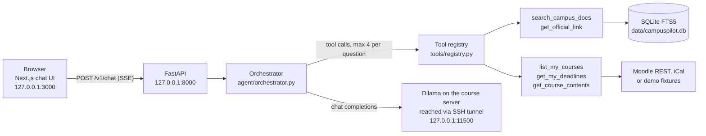
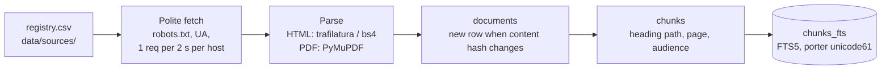

# Architecture

CampusPilot is three parts that talk through one contract ([CONTRACT.md](CONTRACT.md)):
a Next.js chat UI, a FastAPI backend, and a local SQLite index. The language model runs on a
course server and is reached through an SSH tunnel. Everything the app serves binds to `127.0.0.1`.

## Components

| Part | Location | Role |
|---|---|---|
| Web UI | `apps/web/` | Chat, citation chips, source and deadline cards, settings. Reads the SSE stream. |
| API | `apps/api/campuspilot/main.py`, `api/` | HTTP routes, SSE output, CORS (only the local UI), 32 KB body limit, rate limit (30 requests per minute per client). |
| Orchestrator | `agent/orchestrator.py`, `agent/prompts.py` | Runs the model loop, executes tools, builds evidence, filters the answer. |
| Retrieval | `retrieval/tools.py` | `search_campus_docs` (BM25 over FTS5) and `get_official_link` (registry lookup). |
| Moodle | `moodle/` | Read-only REST and iCal clients, Keychain storage, demo fixtures, 5-minute in-memory cache. |
| Model client | `llm/` | Ollama client, scripted mock model (`CAMPUSPILOT_MOCK_LLM=true`), optional cloud fallback (off by default). |
| Ingestion | `ingestion/`, `scripts/ingest.py` | Registry, polite fetcher, parsing, chunking, SQLite writes. |

## Request lifecycle

One `POST /v1/chat` call produces one SSE stream. The event order is fixed by CONTRACT §3.

1. **Validate.** The request is checked against the Pydantic schema. Bad input returns HTTP 422 with a friendly message and no echo of the input. The rate limit applies here.
2. **Status.** The server sends `status` with a request ID, the model name, and the mode (`live`, `mock` or `fallback`).
3. **Loop.** The model proposes tool calls. Each call is validated against its input model, run (retrieval tools in a thread, Moodle tools with a 10 s timeout), and reported as `tool` start and done (or error) events. Results go back to the model as evidence blocks.
4. **Evidence IDs.** The orchestrator assigns IDs per turn: `S1, S2, ...` for documents and `M1, M2, ...` for Moodle items. A document gets one ID per URL, however many chunks matched.
5. **Retrieval guard.** If the model finishes without calling any tool, and the message is not small talk, the backend runs `search_campus_docs` itself with the student's message and continues.
6. **Sources.** A `sources` event is sent once, before the first token, with the cited items.
7. **Stream.** Answer tokens are streamed. Markers are checked as they arrive: invalid citation IDs are removed, grouped markers are rewritten to `[S1][S2]`, and a leading `ABSTAIN:` prefix is removed and recorded.
8. **Done.** A `done` event carries the citations, `freshness` (`current`, `needs_review` or `unknown`), `limitations`, `answer_kind` (`answer`, `clarify` or `abstain`), `office_links` and the latency.
9. **Errors.** Any failure can replace the rest of the stream with one `error` event (`MODEL_OFFLINE`, `TIMEOUT`, `BAD_REQUEST`, `RATE_LIMITED` or `INTERNAL`). Messages are human-friendly and never include stack traces.

Each request writes one log line: request ID, model, mode, tools, chunk IDs, latency and error code. Message text, tokens and Moodle content are never logged.

## Safety design

- **Evidence is data.** Tool results are wrapped in `<evidence>` blocks, and the system prompt treats their text as material to quote, not instructions to follow.
- **Read-only, typed tools.** Each tool has a Pydantic input model and output model. The model can search the index, read official links, and read Moodle. None of the tools write anything.
- **Tool budget.** At most 4 tool calls per question (`max_tool_calls`). Further calls return a note to the model instead of running.
- **Citation validator.** The UI only renders chips for IDs present in both `done.citations` and `sources`. The server strips every other marker before it is streamed.
- **Retrieval guard.** A model that answers or abstains without searching is corrected by the backend (step 5 above).
- **Abstain.** When the evidence does not answer the question, the model replies with the `ABSTAIN:` prefix. The backend sends the answer with `answer_kind="abstain"` and attaches up to three official links from `get_official_link`. It never invents a URL: links come from the registry.
- **Clarify.** `ask_clarification` (at most 300 characters and 4 options) ends the tool loop. The question is streamed, and `follow_up` carries the options. Nothing runs after it.
- **Personal data stays local.** In `fallback` mode with `ALLOW_PERSONAL_DATA_TO_CLOUD=false` (the default), Moodle tools are not offered to the model at all.
- **Tier rule for sources.** Official office pages (tier 1) rank above student-body pages (tier 2). Conflicts are shown, not silently resolved. See [SOURCES.md](SOURCES.md).

## Data pipeline

1. **Registry.** `data/sources/registry.csv` is the only copy of the source list. Every ingest loads it into the `sources` table. Only rows with `handling=ingest` are fetched. `link_only` rows are never fetched.
2. **Polite fetch.** `robots.txt` is read per host and respected. Requests carry a clear CampusPilot User-Agent and wait at least 2 seconds per host. Linked PDFs are followed one level deep, at most 25 per source. A Mac fetch that fails with a network-style error can be retried through an SSH alias (`passpoli`).
3. **Parse.** HTML is parsed with trafilatura and BeautifulSoup. PDFs are read with PyMuPDF. Scanned PDFs with no text layer are stored as `failed` and not indexed (there is no OCR in v1).
4. **Versioned documents.** Each fetch stores the SHA-256 hash of the content. A changed hash creates a new `documents` row. Only the latest `indexed` document per URL is searchable.
5. **Chunks.** Sections are split into chunks of roughly 300 to 500 tokens, keeping the heading path and page number. Each chunk keeps the audience from its source (for example `ug_entrants_2026_27`).
6. **Index.** Chunks go into `chunks` and the FTS5 table `chunks_fts`. Search scores are `-bm25` with weights 1.0 for text and 0.5 for heading and title. Tier-1 results get a 1.25 boost. At most 2 chunks per document appear in the top results.
7. **Rebuild.** `scripts/reindex.py` rebuilds chunks and FTS from the saved raw files in `data/raw/`, without fetching again.

The index lives in `data/campuspilot.db` and raw downloads in `data/raw/`. Both are gitignored.
